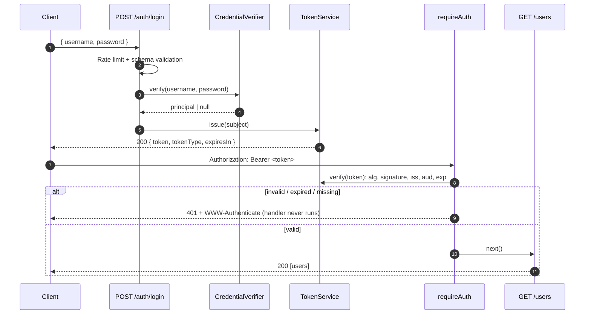

# nodejs-app

**A small, security-hardened TypeScript REST API: JWT authentication, strict validation, tests, and container-ready delivery.**

[](https://github.com/marioportelag/nodejs-app/actions/workflows/ci.yml)


This is a deliberately small service. It started as a backend take-home exercise and has since been rebuilt to
show the engineering baseline expected of a production API, applied at a small scale: fail-fast configuration,
a well-defined authentication boundary, consistent error contracts, automated tests, and reproducible builds.

---

## Features

- **JWT authentication.** HS256 tokens with configurable expiry, plus issuer and audience claims. Verification
  accepts only the expected algorithm.
- **Protected routes.** A Bearer-token middleware whose rejection paths always terminate the request.
- **Request validation.** Strict [Zod](https://zod.dev) schemas for request bodies and route parameters.
- **Consistent errors.** A single JSON error shape with stable machine-readable codes. Internal errors are never
  exposed to clients.
- **Fail-fast configuration.** Environment variables are validated at startup. Missing or weak secrets stop the
  process.
- **HTTP hardening.** Security headers via `helmet`, a 10 kB body limit, login rate limiting, and `X-Powered-By`
  disabled.
- **Structured logging.** JSON logs via `pino`, with `Authorization` and cookie headers redacted.
- **Operability.** A `/health` endpoint, graceful shutdown on `SIGTERM`/`SIGINT`, and a non-root Docker image
  with a healthcheck.
- **Quality gates.** ESLint (type-aware), Prettier, `tsc --strict`, Vitest + Supertest, and GitHub Actions CI.

## Tech stack

| Area       | Choice                                                   |
| :--------- | :------------------------------------------------------- |
| Runtime    | Node.js 24 LTS (22.12+ supported)                        |
| Language   | TypeScript 5.9, `strict`, ES modules                     |
| HTTP       | Express 5, helmet, express-rate-limit                    |
| Auth       | jsonwebtoken (HS256)                                     |
| Validation | Zod 4                                                    |
| Logging    | pino, pino-http                                          |
| Testing    | Vitest, Supertest, V8 coverage                           |
| Tooling    | ESLint (typescript-eslint), Prettier, tsx                |
| Delivery   | Docker (multi-stage, Alpine), GitHub Actions, Dependabot |

## Architecture

```text
src/
├── server.ts              # Process bootstrap: config, listen, graceful shutdown
├── app.ts                 # Express app factory (dependency wiring, middleware order)
├── config/
│   └── env.ts             # Environment schema and typed AppConfig (fail-fast)
├── auth/
│   ├── auth.routes.ts     # POST /auth/login (+ rate limiter)
│   ├── auth.controller.ts # Login handler
│   ├── auth.schemas.ts    # Login request schema
│   ├── auth.middleware.ts # requireAuth: Bearer token guard
│   ├── token.service.ts   # JWT issue/verify (algorithm, iss, aud, exp)
│   └── credentials.ts     # CredentialVerifier interface + demo implementation
├── users/
│   ├── user.routes.ts     # Protected /users routes
│   ├── user.controller.ts # Handlers + route-param validation
│   └── user.store.ts      # In-memory, read-only sample data
└── http/
    ├── errors.ts          # HttpError hierarchy (safe-to-expose errors)
    ├── error-handler.ts   # 404 + centralized error-to-JSON mapping
    ├── validation.ts      # parseRequest(schema, input) → 400 on failure
    └── logger.ts          # pino logger with redaction
```

`createApp()` receives its configuration and logger instead of reading globals, so the tests build isolated app
instances with no network and no environment setup. Login depends on a `CredentialVerifier` interface. The
demo implementation can be swapped for a real user store without changing routes, controllers or token
handling.



## API

| Method | Path          | Auth   | Description                                        |
| :----- | :------------ | :----- | :------------------------------------------------- |
| `GET`  | `/health`     | No     | Liveness probe → `{ "status": "ok" }`              |
| `GET`  | `/greetings`  | No     | Public endpoint → `{ "message": "greetings" }`     |
| `POST` | `/auth/login` | No     | Exchanges credentials for a JWT (rate-limited)     |
| `GET`  | `/users`      | Bearer | Lists users                                        |
| `GET`  | `/users/:id`  | Bearer | Returns one user (`id` must be a positive integer) |

### `POST /auth/login`

```http
POST /auth/login
Content-Type: application/json

{ "username": "demo", "password": "<DEMO_PASSWORD>" }
```

```json
{ "token": "<jwt>", "tokenType": "Bearer", "expiresIn": 900 }
```

`expiresIn` is in seconds. The response carries `Cache-Control: no-store`.

### `GET /users/:id`

```http
GET /users/25
Authorization: Bearer <jwt>
```

```json
{ "id": 25, "name": "camilo", "age": 28 }
```

### Errors

Every error uses one shape:

```json
{
  "error": {
    "code": "validation_error",
    "message": "Request validation failed",
    "details": [{ "path": "password", "message": "Invalid input: expected string, received undefined" }]
  }
}
```

| Status | `code`                | When                                                                     |
| :----- | :-------------------- | :----------------------------------------------------------------------- |
| 400    | `validation_error`    | Body or route parameters fail schema validation (`details` lists fields) |
| 400    | `invalid_json`        | Malformed JSON body                                                      |
| 401    | `invalid_credentials` | Wrong username or password (identical response for both)                 |
| 401    | `missing_token`       | No `Authorization` header                                                |
| 401    | `invalid_token`       | Malformed header, bad signature, wrong algorithm, issuer or audience     |
| 401    | `token_expired`       | Token past its `exp`                                                     |
| 404    | `not_found`           | Unknown route or user                                                    |
| 413    | `payload_too_large`   | Body larger than 10 kB                                                   |
| 429    | `too_many_requests`   | Login rate limit exceeded                                                |
| 500    | `internal_error`      | Unexpected failure (details are logged, never returned)                  |

401 responses include a `WWW-Authenticate: Bearer` challenge, per RFC 6750.

## Authentication workflow

1. The client sends credentials to `POST /auth/login`.
2. The credentials are compared in constant time against the configured demo account.
3. On success, the API returns a JWT signed with `HS256` with claims `sub`, `iss`, `aud`, `iat` and `exp`. Lifetime
   comes from `JWT_EXPIRES_IN_SECONDS` (default 15 minutes).
4. The client calls protected routes with `Authorization: Bearer <token>`.
5. `requireAuth` verifies the signature with an explicit algorithm allow-list (`HS256` only, so `none` and other
   algorithms are rejected), plus issuer, audience and expiry. Any failure ends the request with `401`, and the
   route handler is not invoked. Verified claims are exposed to handlers as `res.locals.auth`.

## Configuration

All configuration comes from environment variables, validated at startup. Copy `.env.example` to `.env` for local
development. The process refuses to start if a required value is missing, too weak, or left as the example
placeholder.

| Variable                     | Required | Default          | Notes                                                                          |
| :--------------------------- | :------- | :--------------- | :----------------------------------------------------------------------------- |
| `JWT_SECRET`                 | **Yes**  | –                | At least 32 characters. Use a random value.                                    |
| `DEMO_USERNAME`              | **Yes**  | –                | Username of the single demo account                                            |
| `DEMO_PASSWORD`              | **Yes**  | –                | At least 12 characters                                                         |
| `JWT_EXPIRES_IN_SECONDS`     | No       | `900`            | 60–86400                                                                       |
| `JWT_ISSUER`                 | No       | `nodejs-app`     | `iss` claim, issued and enforced                                               |
| `JWT_AUDIENCE`               | No       | `nodejs-app-api` | `aud` claim, issued and enforced                                               |
| `PORT`                       | No       | `3000`           |                                                                                |
| `NODE_ENV`                   | No       | `development`    | The Docker image sets `production`                                             |
| `LOG_LEVEL`                  | No       | `info`           | `fatal` … `trace`, or `silent`                                                 |
| `TRUST_PROXY`                | No       | `0`              | Number of trusted reverse-proxy hops (affects client IP used by rate limiting) |
| `LOGIN_RATE_LIMIT_MAX`       | No       | `10`             | Login attempts per window per client IP                                        |
| `LOGIN_RATE_LIMIT_WINDOW_MS` | No       | `900000`         | Rate-limit window (15 minutes)                                                 |

Generate a secret with:

```bash
node -e "console.log(require('node:crypto').randomBytes(48).toString('base64url'))"
```

## Getting started

**Prerequisites:** Node.js 22.12+ (24 LTS recommended, see `.nvmrc`) and npm.

```bash
git clone https://github.com/marioportelag/nodejs-app.git
```

```bash
cd nodejs-app
```

```bash
npm ci
```

```bash
cp .env.example .env
```

Edit `.env` and replace the `JWT_SECRET` and `DEMO_PASSWORD` placeholders, then start the server in watch mode:

```bash
npm run dev
```

Try it, replacing `<DEMO_PASSWORD>` with your value:

```bash
TOKEN=$(curl -s -X POST http://localhost:3000/auth/login \
  -H 'Content-Type: application/json' \
  -d '{"username":"demo","password":"<DEMO_PASSWORD>"}' \
  | node -pe 'JSON.parse(require("fs").readFileSync(0)).token')
```

```bash
curl -s http://localhost:3000/users -H "Authorization: Bearer $TOKEN"
```

A Postman collection (`Collection.postman_collection.json`) is included. Set its `password` variable to run the
login request, which stores the token for the protected requests.

## Development commands

| Command                                   | Purpose                                                              |
| :---------------------------------------- | :------------------------------------------------------------------- |
| `npm run dev`                             | Start with hot reload (tsx), loading `.env` if present               |
| `npm run build`                           | Compile to `dist/`                                                   |
| `npm start`                               | Run the compiled build, loading `.env` if present                    |
| `npm test`                                | Run the test suite once                                              |
| `npm run test:watch`                      | Run tests in watch mode                                              |
| `npm run test:coverage`                   | Run tests with a V8 coverage report                                  |
| `npm run lint`                            | ESLint (type-aware rules)                                            |
| `npm run typecheck`                       | `tsc --noEmit` over sources and tests                                |
| `npm run format` / `npm run format:check` | Prettier write / verify                                              |
| `npm run check`                           | Everything CI runs on the code: format, lint, typecheck, test, build |

## Testing

```bash
npm test
```

The suite runs fully in-process: no network, database or `.env` needed. It covers:

- **Login:** success (token claims, algorithm and lifetime asserted), wrong password, unknown user, missing
  credentials, missing body, invalid payload types, unexpected fields, malformed JSON, oversized body, and rate
  limiting.
- **Middleware:** missing header, non-Bearer schemes, malformed, truncated, tampered and wrongly signed tokens,
  `HS512` and `alg: none` tokens, wrong issuer or audience, a missing subject, and expired tokens. Each case asserts
  that the protected handler is **never invoked**, using a spy.
- **Protected routes:** valid-token access end to end, 404 and 400 on bad ids, and a check that rejected requests
  never reach the data store.
- **Configuration:** fail-fast on missing, weak or placeholder secrets, without echoing secret values.
- **HTTP hardening:** security headers present and `X-Powered-By` absent.

## Docker

The image is a multi-stage build on `node:24-alpine`. The runtime stage contains only compiled JavaScript and
production dependencies. It runs as the unprivileged `node` user, application files are read-only to that user,
and the image defines a `HEALTHCHECK` against `/health`. No secrets are baked into the image; provide them at
runtime.

```bash
docker build -t nodejs-app .
```

```bash
docker run --rm -p 3000:3000 --env-file .env nodejs-app
```

If you change `PORT` in `.env`, adjust the `-p` mapping to match. `docker stop` sends `SIGTERM`, which triggers
a graceful shutdown.

## CI/CD

[`.github/workflows/ci.yml`](.github/workflows/ci.yml) runs on pushes to `main`, on pull requests, and manually:

1. **Verify** (Node 22 and 24): `npm ci` → format check → lint → type check → tests with coverage → build →
   `npm audit --audit-level=high`.
2. **Docker image** (after verify): builds the image without pushing it, starts it with generated throwaway
   secrets, and polls `/health`.

The workflow uses `permissions: contents: read` and actions pinned to full commit SHAs, and it does not persist
checkout credentials. There is **no deployment step**: nothing is published or deployed automatically.
Dependabot (`.github/dependabot.yml`) proposes weekly updates for npm packages, GitHub Actions and the Docker
base image.

## Security considerations

- **Secrets** come only from the environment. Startup fails on missing, short or placeholder values. `.env` is
  git-ignored, and logs redact `Authorization` and cookie headers.
- **Token verification** pins the algorithm (`HS256`) and enforces `iss`, `aud` and `exp`. Expired and invalid
  tokens get distinct error codes but the same status (`401`).
- **Credential checks** use constant-time comparison, and the same error is returned for an unknown user or a
  wrong password, to avoid user enumeration.
- **Brute-force mitigation:** per-IP rate limiting on `POST /auth/login`. Set `TRUST_PROXY` correctly behind a
  load balancer so the limiter sees real client IPs.
- **Input handling:** strict schemas reject unknown fields, wrong types and oversized values. Bodies are capped
  at 10 kB.
- **Supply chain:** dependency audit in CI, Dependabot updates, SHA-pinned actions, and a reproducible
  `npm ci` from the lockfile.

## Known limitations

This is intentionally a compact reference service, not a complete identity system.

- **Demo authentication only.** There is one account, configured through environment variables. The password
  is held in plain text in the process environment and compared directly. There is no user database, password
  hashing (e.g. argon2/bcrypt), account lockout, MFA, or account management. Replace `DemoCredentialVerifier`
  with a real `CredentialVerifier` before using this pattern for real users.
- **No token lifecycle management.** There are no refresh tokens, no revocation or deny-list, and no key
  rotation. Tokens stay valid until `exp`.
- **Symmetric signing.** HS256 suits a single service. Multi-service setups should prefer asymmetric keys
  (RS256/EdDSA) published via JWKS.
- **In-memory state.** User data is static sample data. The rate limiter's counters are per process and reset on
  restart, so a multi-instance deployment needs a shared store.
- **No authorization model.** Any authenticated principal can read all users; there are no roles or scopes.
- **No CORS policy.** The API is not configured for browser cross-origin use.
- **TLS** is expected to be terminated by a reverse proxy or platform. The app serves plain HTTP.
- **No hosted demo** is maintained, and no OpenAPI document is published yet.
- **Git history:** earlier commits contain expired demo JWTs signed with the former hardcoded secret. That
  secret and those claims are not accepted by the current version.

## Changes from v1

v2 is a deliberate, breaking rewrite of the original exercise:

- The login route is `POST /auth/login`. The v1 README documented `/login`, which never existed.
- The login response is `{ token, tokenType, expiresIn }` (previously `{ success, token }`).
- Invalid or expired tokens return `401` with `WWW-Authenticate` (previously `403`).
- User objects use `age` instead of `edad`.
- Errors use the `{ "error": { code, message, details? } }` envelope.
- Credentials and the JWT secret are no longer hardcoded and must be configured.
